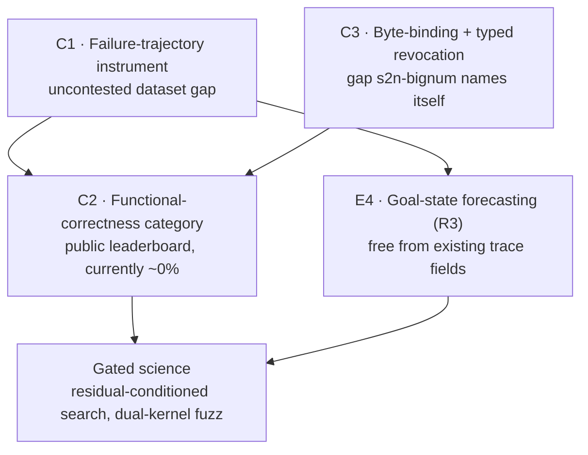

# Tekmerion — verdict on the frontier brief

**Date:** 2026-11-22
**Basis:** source inspection of four repositories at pinned commits, the public benchmark
abstract and leaderboard, the CVE advisory, and an arXiv sweep. Every load-bearing claim
below was checked against a source; see `01-PRIOR-ART.md` for the evidence table and
`sources.md` for URLs and commit hashes. Claims I could not verify are marked as such.

---

## The verdict

The brief is directionally right and tactically wrong. Its stated target — beat 6.35% on
s2n-bignum-bench — is not the frontier, and three of its ledger rows are indefensible as
written. But inside the brief there is a cheaper, harder-to-attack programme: **three
claims, each with a named external adjudicator, ordered so that the first two are very
likely to succeed and the third closes a gap the reference implementation names itself.**

The single most important correction: **the functional-correctness category sits at
effectively zero and is the real frontier.** All original baselines solve **0 of 864**
functional-correctness tasks; the refreshed v1.1 snapshot records the first five successes,
all among the smallest tasks. Going from ~0% to a replay-checked handful on that category
is a first. Going from 6.35% to 7% on the aggregate, using an agentic loop that the
benchmark authors already published at 10.26%, is a non-result.

---

## Corrections that must land before any claim is written

| # | The brief says | What the source says | Consequence |
|---|---|---|---|
| 1 | "≤ 6.35% ... zero-shot frontier models" is *the* number to beat | Same abstract: **10.26% Pass@5** with execution feedback; **0/864** functional-correctness for all original baselines; v1.1 first **5** FC successes, all smallest | Beating 6.35% with a feedback loop re-runs a published arm. Target FC instead, or compare against 10.26% at equal budget. |
| 2 | The frontier is unclaimed, so any beat is first | Public leaderboard exists; repository has **0 issues, 0 forks**, no `results.json` on `master`, last push 2026-09-25; submissions arrive as issues | The scoreboard is genuinely empty — but a submission is adjudicated by the authors (incl. the HOL Light author). Compare the right arms or it is rejected. |
| 3 | T2 trajectory capture is new work | `TacticTrace` already wraps every tactic/conv and records `{goal_before, goals_after, num_subgoals}` as JSON, CI-tested and pinned by the harness | Reimplementing it is a straight credibility loss. Consume it. |
| 4 | (implied) capture is the contribution | `TacticTrace`: "the proof ends with an explicit `exptrace_dump ()`, so **a proof that fails writes no traces**" | The one thing best-in-class capture discards is exactly the programme's thesis. That is the seam. |
| 5 | "No published number" for proof repair | CAPRI: 138/180 valid repairs, 32/36 frozen iterative, contract violations measured; VerusWeave 75–85% / 29–47%; TopoVerus 61.6/72.2 Safe-Pass; APRIL 260k repair tuples | Delete the row or re-scope to *ISA-model-induced* breakage of machine-code proofs, which is unmeasured. |
| 6 | "No published number" for lemma yield | QuickSpec, HR/CVC, AProS, and template-based conjecturing are a two-decade line | Re-scope to *residual-conditioned lemma selection inside HOL Light*. |
| 7 | M3 ISA model court is new | s2n-bignum already runs CI co-simulation against an independent execution backend across reg/reg forms and memory-addressing harnesses | The novel part is digest-binding, a vendor-derived third leg, and mutation controls — not the court. |
| 8 | 2,633 lines for `bignum_inv_p25519` | At commit `1d097f6`: `arm` **3,624** lines (3,346 code), `x86` **4,617** (4,090); correctness thm at 3315, `SAFE` at 3540/3590 | The number does not reproduce. Pin it to a commit and a counting rule or drop it; a reviewer will check. |
| 9 | HOL Light kernel is 680 lines | `fusion.ml` is **680 lines total, 400 non-blank/non-comment**, 10 inference primitives, one axiom-introducer | Both published numbers are right. The TCB table must state which boundary it means. |
| 10 | M14 proofs-as-evidence is new | That is Necula's proof-carrying code plus content-addressed supply-chain attestation | The defensible claim is *typed revocation* and a *measured* revocation precision, not the idea. |
| 11 | "Every instrument proves its sensitivity" is our discipline | Refusal-site mutation testing is published (arXiv 2608.26183, Aug 2026): 112 refusal sites, 75 deletable unnoticed, score 0.330 | Adopt and cite it. Do not claim it. |

Two further structural findings:

- **The CVE is definitional, not inferential.** CVE-2026-72844 was a type-confusion in
  projection checking plus `add_inductive` not type-checking nested inductive parameters.
  Nanoda and Lean4Lean were affected because they replay the same rules. The lesson is not
  "two kernels agree"; it is that **the discriminating defence is a bridge that must
  *translate* a definitional declaration and fails closed when it cannot.** Test definitional
  forms, not inference rules.
- **"Build a new proof assistant" is the trap.** Candle already gives a HOL Light-compatible
  prover verified to machine code. A Rust kernel buys no measurable assurance and costs
  years. The assets that actually differentiate this programme are instrumentation,
  adjudication and evidence binding — which is precisely where the FRF/DSFB/Gemel work sits.

---

## The programme I would actually run

Three claims. Each has an adjudicator that is not us.



| Claim | Adjudicator | Prior art | Novelty class | Cost | P(positive result) |
|---|---|---|---|---|---|
| **C1** Lossless failure-side traces on an industrial machine-code proof corpus | Bit-identical success records vs `TacticTrace`; replay of failure events | Success-only tracing; LLM error-string feedback; APRIL synthetic failures | `UNVERIFIED_COMBINATION` | Low (weeks) | High |
| **C2** First replay-checked solve rate on the functional-correctness category | Public leaderboard, `CHEATING` check, per-problem timeouts | 0/864 baselines; 5/898 v1.1 | `PLAUSIBLY_NOVEL` as a category result | Medium (needs the 20 GB build + model budget) | Medium |
| **C3** Byte-binding with typed revocation, measured | Reproducible local harness with ground truth by construction | PCC, SBLA/SLSA, s2n-bignum's own reassembly caveat | `PLAUSIBLY_NOVEL` (measurement) | Low | High |
| **E4** Goal-state forecasting from existing traces | Structural distance vs observed `goals_after` | Tactic prediction; premise selection; value functions | `UNVERIFIED_COMBINATION` | Very low | Medium |
| **E5** Definitional differential fuzzing, CVE-seeded | Planted unsound rules; refusal-site mutation score | Differential testing; published refusal-site mutation | `PLAUSIBLY_NOVEL` as a target | Medium | Medium |

**C1 is first because it is the substrate.** You cannot evaluate residual-conditioned
scheduling without failure trajectories, and no one has a lossless labelled corpus of them
on this benchmark. C1 also produces a permanent, reusable artefact, which is the most
durable kind of win in this field.

**C2 is second because the scoreboard is empty and at zero.** The mechanism I would bet on
is not residual magic; it is **cross-task lemma transfer inside one proof corpus**. The
898 functional-correctness tasks share carry, limb and Montgomery structure, and the
baselines fail because a single-shot model cannot recall library lemmas it has never seen.
A system that carries kernel-accepted lemmas from earlier tasks into later ones attacks
exactly that failure. This is honest: the lever is retrieval plus reuse, and the ablation
will show whether DSFB adds anything on top.

**C3 is third because it is cheap and closes a named gap.** `SOUNDNESS.md` states there is
no systematic check that downstream reassembly produces the bytes the proofs were about.
The crate in `src/` implements the typed model and measures it.

**E4 is the best idea in the brief, and the brief does not know it.** `TacticTrace` records
`goal_before` and `goals_after`. Therefore the forecast residual R3 — ask the proposer to
predict the post-tactic goal state, compare with the observed one — **is computable today
with zero new instrumentation**, on a public benchmark. I could find no prior system that
scores predicted goal states this way; the field predicts *tactics*, not *their result*.

---

## What I would refuse, and why

Refusing is the part that protects the programme.

- **Dual-kernel acceptance over the whole corpus (M1/T5).** Candle's documented coverage does
  not extend to the HOL Light libraries s2n-bignum uses (this is an assessment, not a
  measurement — see `01-PRIOR-ART.md` §E), and hol2dk's scale is 52 GB and ~8 h for
  `topology.ml`. Set this as a research track on a *declared fragment*, never as a gate for
  T5–T9.
- **Speculative constant time on shipped bytes (M13).** Real and important, but it needs a
  formal hardware–software contract and a model of speculation the current ISA models do
  not have. It is a multi-year claim. Do not put it in a phase gate.
- **A new proof kernel in Rust.** No measurable assurance advantage over Candle; large
  trust cost.
- **"No published number, so we set the first" as a strategy.** Four of the six such rows
  are occupied. A first measurement on a scoreboard nobody runs is not a frontier result;
  it is a footnote. Use those measurements as *instrumentation*, not as claims.

---

## Addressing "a negative result is pointless"

This instinct is right about *programme design* and wrong about *experiment design*. A
negative result is worthless when the experiment was unfalsifiable, was a re-run of a
published arm, or had no kill criterion — because then a null is indistinguishable from a
bug. The fix is not to avoid negatives. It is:

1. Only run experiments with positive expected value of information.
2. Preregister a kill criterion, so a null is a clean fact rather than a failure.
3. Order the programme so the first two results are likely positive (C1, C3), buying the
   credibility that lets a null on C2 or E4 be published rather than buried.

That is why C1 and C3 come before any residual-conditioned search.

---

## Immediate actions, in order

```sh
# 0. Everything below runs on this machine: ocaml 5.5.0, opam 2.3.0, cargo 1.98, 16 cores.
cd /mnt/1tb_kingston/Tekmerion

# 1. Reproduce the measurements (no network, no 20 GB build).
cargo test --offline
python3 tools/mutate.py
cargo run --offline --example reassembly

# 2. Build the benchmark environment (needs ~20 GB and ~1 h).
git clone https://github.com/kings-crown/s2n-bignum-bench /tmp/s2n-bignum-bench
cd /tmp/s2n-bignum-bench && ./setup.sh arm 8 && ./setup.sh --reuse x86 8
python3 collect-problems.py toplevel-thms/ problems.json ml_files

# 3. C1: extend the generated kernel wrapper to catch tactic exceptions.
#    Conformance target: success records bit-identical to TacticTrace.
#    See research/03-INSTRUMENT.md for the exact insertion point and schema.

# 4. C2: reproduce the 6.35% and 10.26% arms before claiming anything.
#    Only then run the lemma-transfer arm.
```

Disk note: this volume has 36 GB free. The bench needs ~20 GB. Do not run the build and
a large model cache on the same volume without checking.

---

## What this document does not establish

Nothing here is a frontier claim. It is a prior-art audit, a corrected ledger, and a
measured conformance test of one component on synthetic data. The programme's claims begin
at C1.
